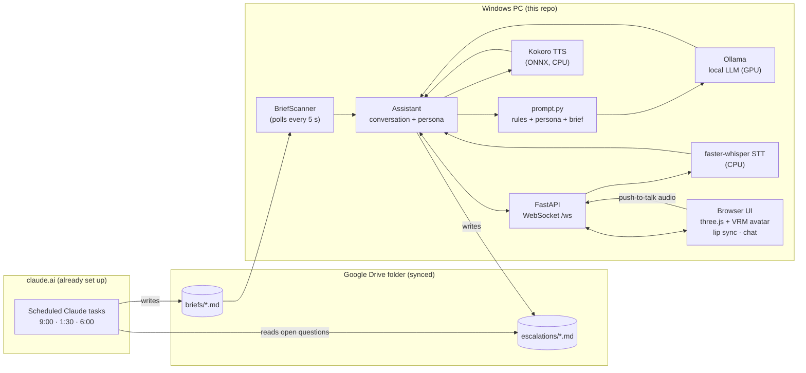

# Desk Secretary

[](https://github.com/cooperyungblut/desktop-assistant/actions/workflows/ci.yml)

A local AI secretary with a 3D avatar and a voice. Three times a day, a
scheduled Claude task reads my email and calendar and writes a short brief
into a synced Google Drive folder. This app picks the brief up, shows a
**brief ready** indicator, and when I click, a VRM avatar reads it aloud with
lip sync. Then I can ask follow-up questions, which a local LLM answers in
character.

Everything on the PC runs locally: no cloud calls and no running costs.

https://github.com/user-attachments/assets/f6dc1b93-f154-4ee3-8c28-ec2f78aa97e9


## Features

- **Brief pickup**: polls the synced folder, validates each file against a
  versioned format, and never starts talking on its own.
- **Readout**: Kokoro text-to-speech, streamed sentence by sentence, with
  amplitude-based lip sync on a VRM avatar (three.js + three-vrm).
- **Follow-ups**: a local model through Ollama, with the brief as context and
  the session's conversation history, streamed token by token.
- **Persona as config**: name, traits, speaking style, answer length, example
  lines, sampling settings and voice all live in a YAML file.
- **Accuracy over personality**: the readout is read verbatim (it never passes
  through the local model), and fixed rules in code stop any persona from
  changing facts.
- **In-character framing**: around the verbatim readout she adds a first
  reaction, a couple of quick asides between paragraphs and a closing line,
  written by the local model in the persona's voice. Lines with numbers or
  names that aren't in the brief are dropped, and if the model isn't ready
  within 3 s she just reads the brief. `scripts/try_framing.py` previews it.
- **Expressions**: the model opens each reply with a mood tag (`[happy]`,
  `[sad]`, …) that the app strips from the text and speech and turns into an
  eased VRM facial expression. The moods are fixed in code; how each one looks
  is set per persona.
- **Voice input**: hold V to ask out loud, or click the mic button, talk, and
  pause (it sends after 3 s of silence). faster-whisper transcribes on the
  GPU (CPU works too), with names from the current brief as hints, and
  talking over the avatar interrupts her.
- **Model eval**: `scripts/eval_models.py` scores local models on keeping the
  brief's facts right, admitting what it doesn't know, mood tags and speed.
- **Desktop window**: an Electron shell shows just the avatar in a
  frameless, transparent, always-on-top window on the desktop. Clicks pass
  through her except on her buttons, global hotkeys talk or read a brief
  from any app, and a chat panel opens on either side of her (it flips sides
  at a screen edge, and she never moves for it). It renders on the GPU and
  drops to 30 fps while she's idle. "Read me this morning's brief" works
  typed or spoken.
- **Escalation**: `/claude <question>` (or "check with Claude…") saves the
  question to a file that the next scheduled brief answers.

## Results

Measured on my PC (RTX 4070 Ti Super, 16 GB), with `gemma4:12b` in Ollama:

| | |
|---|---|
| First word of a reply | about 0.4 s (was 7–35 s until hidden "thinking" was turned off) |
| Speech to text | 0.3–0.6 s per question (Whisper `small.en` on the GPU) |
| Model eval | 100% on facts kept, "I don't know" and mood tags (15 cases × 3 runs) |
| Desktop window, idle | about 1.4% CPU, WebGL on the GPU, 30 fps cap |
| Tests | 118 Python (pytest) + desktop shell helpers (node), on Windows and Linux CI |

The stories behind these numbers are in
[`docs/interview-notes.md`](docs/interview-notes.md).

## Architecture



| Piece | Where | Why it's built this way |
|-------|-------|-------------------------|
| File contract | [`docs/formats.md`](docs/formats.md) | Markdown + YAML front matter is easy for an LLM to write and for a person to read. One writer per file avoids Drive sync conflicts. |
| Folder watcher | `watcher.py` | Polling, not file-system events: Drive for Desktop doesn't reliably raise them, and briefs arrive three times a day. Half-synced files fail validation and are retried. |
| Prompt assembly | `prompt.py` | Rules live in code, not the persona file. A short persona reminder is re-injected before every question, because small models drift. Brief content is wrapped as untrusted data. |
| Assistant | `assistant.py` | Transport-agnostic. It emits events through a callback, so tests collect them in a list and the server forwards them over a WebSocket. |
| LLM client | `llm.py` | Raw `httpx` streaming against `/api/chat`. The token stream is cut into sentences so speech starts before the reply finishes. |
| STT | `stt.py` | faster-whisper on CPU: the GPU is reserved for the LLM. Audio is decoded with PyAV directly. A VAD filter plus a tiny deny-list handles Whisper's "silence hallucinations". |
| TTS | `tts.py` | `kokoro-onnx` on CPU: no PyTorch install, faster than real time, and it leaves VRAM for the LLM. |
| Front end | `web/` | Plain ES modules with an import map: no Node, no bundler. Markdown from briefs is sanitized with DOMPurify, since it contains email text. |
| Desktop shell | `desktop/` | Electron, because transparent, frameless, click-through windows are reliable on Windows there. It only loads the app's page with `?desktop` (avatar-only layout), so the Python app stays the single source of truth. The page gets a few narrow calls through a preload bridge, never Node. |

## Quick start (Windows, PowerShell)

Prerequisites: Python 3.11 or 3.12, [uv](https://docs.astral.sh/uv/),
[Ollama](https://ollama.com).

```powershell
git clone https://github.com/cooperyungblut/desktop-assistant.git
cd desktop-assistant
uv sync --extra tts --extra stt     # Python deps, including Kokoro and Whisper
uv run python scripts/download_models.py   # Kokoro model files (~340 MB)
ollama pull gemma4:12b              # or any chat model; set it in config.yaml
Copy-Item config.example.yaml config.yaml
# Save a VRM avatar as web/models/avatar.vrm (see web/models/README.md)
uv run python scripts/drop_sample.py       # fake brief into data/inbox
uv run desk-secretary               # opens http://127.0.0.1:8765
```

Click **Morning brief ready** (or press Space). Type a follow-up question or
hold **V** and ask it out loud. Start with `/claude` (or say "check with
Claude…") to save it for the next brief.

To put her on the desktop instead of a browser tab (needs [Node.js](https://nodejs.org) LTS):

```powershell
cd desktop
npm install    # once
npm start      # starts the app too, and stops it when you quit her
```

To use the real synced folder, set `secretary_dir` in `config.yaml` (which is
git-ignored) to the Drive folder that contains `briefs/`.

## Customizing the persona

Edit [`personas/juniper.yaml`](personas/juniper.yaml), or copy it and point
`persona_file` at the copy. Voices are listed in [`docs/voices.md`](docs/voices.md).

## Development

```powershell
uv run pytest           # tests (no models or GPU needed)
uv run ruff check .     # lint
uv run ruff format .    # format
cd desktop; npm test    # desktop shell helpers
```

CI runs lint and tests on Windows and Linux, plus a privacy check that fails
if anything that looks like a real brief, escalation, config file or avatar is
committed.

## Privacy

Real briefs contain email and calendar data. They stay in the synced folder,
which lives outside the repo. `config.yaml`, `data/`, `models/` and avatar
files are git-ignored. Everything under `samples/` is invented.

## Roadmap

Milestones 1–4 are done. Next up, in [`docs/plan.md`](docs/plan.md): a wake
word, allow-listed actions, an offline Wikipedia she can look things up in,
and watching the screen to comment on a game.

## AI assistance

This project was built with [Claude](https://claude.ai) (Anthropic) as a
coding partner. Claude wrote most of the code, including the core logic, from
my requirements and architecture decisions. I reviewed, ran and tested it.
The briefs themselves are produced by Claude scheduled tasks in claude.ai.

## License

MIT
